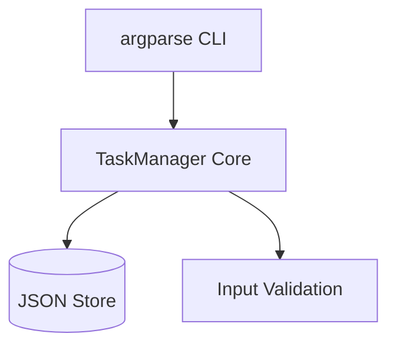

## Synopsis

A CLI-based task manager in Python supporting add/list/complete operations with JSON persistence. Built as a learning vehicle for Python project structure and basic file I/O.

*(~30 words — limit: 100)*

## Current Status

**Phase:** Active development  
**Health:** Green — core features working, no open blockers  
**Last commit:** `feat: add due-date filtering` (2026-11-04)

## Key Points

- JSON file persistence (`tasks.json`)
- argparse CLI with subcommands (`add`, `list`, `done`)
- Unit-tested with pytest
- Next: add priority levels and CSV export

## Decision Rationale

**Why JSON persistence?** Chose JSON over SQLite to keep the tool zero-dependency and portable across machines for personal task tracking. A database would add operational overhead for a single-user CLI tool.

## Architecture

One mermaid diagram per project (limit: 1).

## Related Work

- Source: `~/dev/devlopment/python/taskList/`
